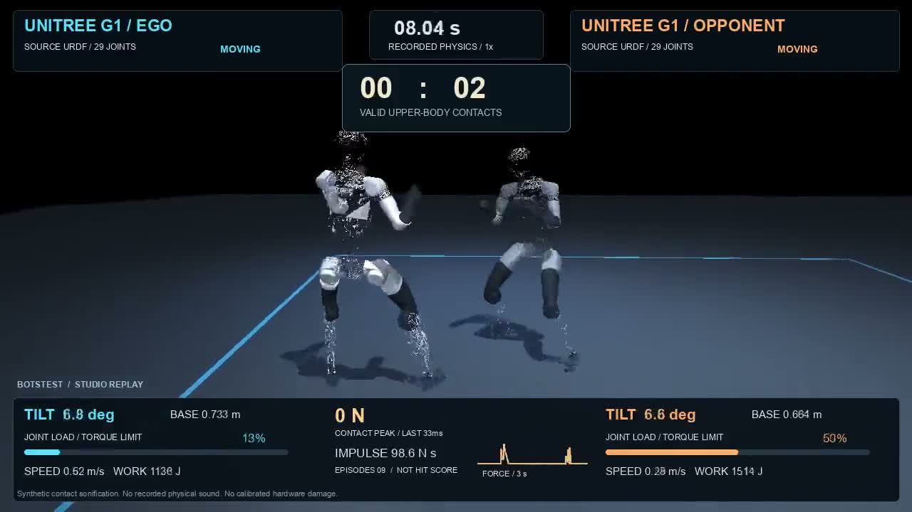
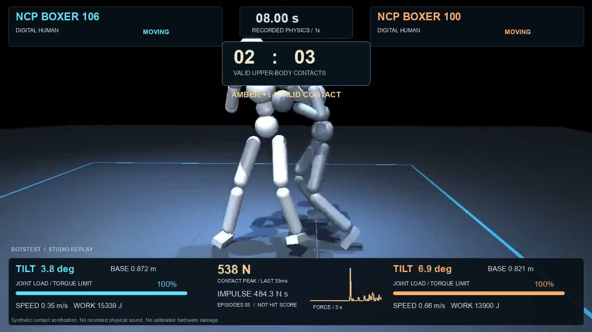
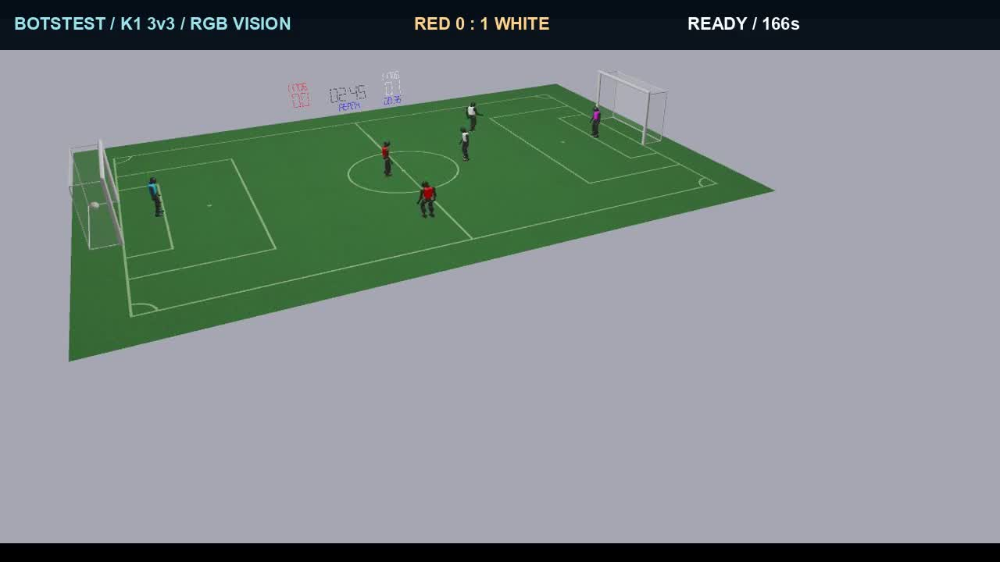

# Awesome Embodied AI [](https://awesome.re)

[English](README.md)

具身智能与机器人资源精选：连接元器件、硬件、软件、模型、数据集、基准、公司、产品和研究资料。

由 [BotsTest](https://botstest.com/) 维护。收录机器人直接相关资源，以及明确标注的基础支持工具；所有链接直接指向资源来源。

## 本仓库特色：原创机器人对抗评测

**从资源目录到实际运行：BotsTest 在本机适配并运行三条对抗赛道，公开完整比赛视频、中文配音字幕、结果与验证记录。**

[查看全部12场比赛与结果](projects/robot-combat-lab/results/tournaments/round-04/published/README.md) · [项目与复现说明](projects/robot-combat-lab/README.md) · [赛制与评价标准](projects/robot-combat-lab/docs/COMPETITION_PROTOCOL.zh-CN.md)

### G1 × RoboStriker：机器人策略对抗

在MuJoCo中运行G1的ego/opponent预训练策略，交换站位并包含同策略对照，共4场。记录有效上身接触、倒地与恢复；逐物理步回放复核全部通过。示例：34:40，橙方按接触计分胜出。

[](projects/robot-combat-lab/results/tournaments/round-04/published/videos/g1-robostriker_ego-robostriker_opponent.zh-CN.mp4)

[播放完整解说视频](projects/robot-combat-lab/results/tournaments/round-04/published/videos/g1-robostriker_ego-robostriker_opponent.zh-CN.mp4) · [字幕](projects/robot-combat-lab/results/tournaments/round-04/published/matches/g1-robostriker_ego-robostriker_opponent/captions.zh-CN.srt) · [解说稿](projects/robot-combat-lab/results/tournaments/round-04/published/matches/g1-robostriker_ego-robostriker_opponent/script.zh-CN.txt)

### NCP：复杂数字人格斗

运行NCP的106/100策略，共4场，展示连续攻防、失衡和恢复。示例接触统计23:27，但双方恢复失败，裁判判技术平局；如实区分接触领先与比赛胜负。此赛道使用数字人，不代表机器人硬件性能。

[](projects/robot-combat-lab/results/tournaments/round-04/published/videos/ncp-106-100.zh-CN.mp4)

[播放完整解说视频](projects/robot-combat-lab/results/tournaments/round-04/published/videos/ncp-106-100.zh-CN.mp4) · [字幕](projects/robot-combat-lab/results/tournaments/round-04/published/matches/ncp-106-100/captions.zh-CN.srt) · [解说稿](projects/robot-combat-lab/results/tournaments/round-04/published/matches/ncp-106-100/script.zh-CN.txt)

### B-Human：RGB视觉自主足球

6台K1进行3v3比赛，通过SimRobot相机与B-Human视觉控制链路自主比赛，由原生裁判判定进球和终场。4场完整比分为3:2、0:4、0:2、1:3。双方运行同一套程序的不同队伍配置，不是独立视觉模型排名。

[](projects/robot-combat-lab/results/tournaments/round-04/published/videos/vision-01.zh-CN.mp4)

[播放完整解说视频](projects/robot-combat-lab/results/tournaments/round-04/published/videos/vision-01.zh-CN.mp4) · [字幕](projects/robot-combat-lab/results/tournaments/round-04/published/matches/vision-01/captions.zh-CN.srt) · [解说稿](projects/robot-combat-lab/results/tournaments/round-04/published/matches/vision-01/script.zh-CN.txt)

**如何理解这些结果：**本轮采用180秒本地计分/比赛窗口，格斗允许恢复失败提前终止；不等同于官方基准复现。三条赛道分别统计，不跨任务排总榜，也不宣称能预测真实硬件损坏。12场视频全部通过录制校验；原片、配音母版与详细物理档案保留在本机，公开版提供可播放视频、字幕、事件证据和SHA-256清单。


当前版本：2026-10-11。2000 个收录网址，9 个主类，55 个可用子类。完整候选档案保留2042个历史核验网址；16个已排除，26个待复核。

收录、编辑复核与链接核验是不同状态。核验日期来自历史记录；本次没有重新联网检测所有网址或安装测试。排序是目录发现线索，不能替代任务适用性、性能或采购验证。

## 导航

- [核心元器件 (38)](lists/components.zh-CN.md)
- [硬件平台 (73)](lists/hardware.zh-CN.md)
- [软件工具 (1169)](lists/software.zh-CN.md)
- [模型 (190)](lists/models.zh-CN.md)
- [数据集 (87)](lists/datasets.zh-CN.md)
- [基准与评测 (57)](lists/benchmarks.zh-CN.md)
- [公司 (175)](lists/companies.zh-CN.md)
- [产品 (28)](lists/products.zh-CN.md)
- [研究与学习 (183)](lists/research.zh-CN.md)

## 如何使用

从任务对应的分类与子类进入。确认软件版本、接口、训练/推理条件与许可证范围后，再访问官方资料。英文与中文使用同一数据及同一排序。

以下为各类分数最高的最多8个入口；分类文件提供全部收录资源。按同类分数降序展示，同分按名称、规范网址排序。精选门槛及完整公式见[排序说明](RANKING.zh-CN.md)。

## 核心元器件

[全部38个资源](lists/components.zh-CN.md)

- [oomwoo-pcb](https://github.com/makerspet/oomwoo-pcb) — oomwoo-pcb：电源与电子器件领域的项目或参考资源。具体用途（英文原文）：I/O board for open-source vacuum cleaner robot。 [详情](https://botstest.com/resources/makerspetoomwoo-pcb-06e0c8/)
- [open_robot_actuator_hardware](https://github.com/open-dynamic-robot-initiative/open_robot_actuator_hardware) — open_robot_actuator_hardware：执行器与电机领域的项目或参考资源。具体用途（英文原文）：Open Robot Actuator Hardware。 [详情](https://botstest.com/resources/open-dynamic-robot-initiativeopen_robot_act-fa5b85/)
- [ATI Industrial Automation](https://www.ati-ia.com/) — ATI Industrial Automation 提供六维力传感器及机器人末端接口设备。 [详情](https://botstest.com/resources/ati-industrial-automation/)
- [Bosch Sensortec](https://www.bosch-sensortec.com/) **[基础支持资源]** — Bosch Sensortec 开发用于惯性测量和运动感知的 MEMS 传感器。 [详情](https://botstest.com/resources/bosch-sensortec/)
- [Bota Systems](https://www.botasys.com/) — Bota Systems 开发用于机器人交互与操作的六维力传感设备。 [详情](https://botstest.com/resources/bota-systems/)
- [Hailo](https://hailo.ai/) **[基础支持资源]** — Hailo 开发用于本地感知与推理计算的边缘 AI 加速器。 [详情](https://botstest.com/resources/hailo/)
- [Harmonic Drive](https://www.harmonicdrive.net/) — Harmonic Drive 提供用于机器人关节的谐波减速器和精密运动部件。 [详情](https://botstest.com/resources/harmonic-drive/)
- [Infineon](https://www.infineon.com/) **[基础支持资源]** — Infineon 提供用于驱动电子设备与嵌入式系统的功率及控制半导体。 [详情](https://botstest.com/resources/infineon/)

## 硬件平台

[全部73个资源](lists/hardware.zh-CN.md)

- [oomwoo](https://github.com/makerspet/oomwoo) — oomwoo：DIY与教育硬件领域的项目或参考资源。具体用途（英文原文）：Open-source vacuum robot cleaner。 [详情](https://botstest.com/resources/makerspetoomwoo-ea80a7/)
- [OpenCatEsp32-Quadruped-Robot](https://github.com/PetoiCamp/OpenCatEsp32-Quadruped-Robot) — OpenCatEsp32-Quadruped-Robot：DIY与教育硬件领域的项目或参考资源。具体用途（英文原文）：An ESP32-based open source quadruped robot pet framework for developing Boston Dynamics-style four-legged robots that are perfect for STEM, coding & robotics education, IoT robotics applications…。 [详情](https://botstest.com/resources/petoicampopencatesp32-quadruped-robot-965b87/)
- [OpenCat-Quadruped-Robot](https://github.com/PetoiCamp/OpenCat-Quadruped-Robot) — OpenCat-Quadruped-Robot：DIY与教育硬件领域的项目或参考资源。具体用途（英文原文）：An open source quadruped robot pet framework for developing Boston Dynamics-style four-legged robots that are perfect for STEM, coding & robotics education, IoT robotics applications, AI-enhanced…。 [详情](https://botstest.com/resources/petoicampopencat-quadruped-robot-7fac80/)
- [popi_project](https://github.com/popi-mkx3/popi_project) — popi_project：DIY与教育硬件领域的项目或参考资源。具体用途（英文原文）：Here is everything you need to know about POPI, our open-source quadruped robot. If you want to check the videos we will release about it, you can have a look at our YouTube channel。 [详情](https://botstest.com/resources/popi-mkx3popi_project-082df2/)
- [OpenCat-Old](https://github.com/PetoiCamp/OpenCat-Old) — OpenCat-Old：DIY与教育硬件领域的项目或参考资源。具体用途（英文原文）：Historical reference: A programmable and highly maneuverable robotic cat for STEM education and AI-enhanced services。 [详情](https://botstest.com/resources/petoicampopencat-old-d3f6a6/)
- [open quadruped](https://github.com/adham-elarabawy/open-quadruped) — open-quadruped 是提供步态生成与机身姿态控制的三维打印四足机器人项目。 [详情](https://botstest.com/resources/adham-elarabawy-open-quadruped/)
- [OpenArm](https://github.com/enactic/openarm) — 用于物理人工智能研究的 OpenArm 人形机器人手臂项目。 [详情](https://botstest.com/resources/enactic-openarm/)
- [tidybot2](https://github.com/jimmyyhwu/tidybot2) — tidybot2：机械臂领域的项目或参考资源。具体用途（英文原文）：TidyBot++: An Open-Source Holonomic Mobile Manipulator for Robot Learning。 [详情](https://botstest.com/resources/jimmyyhwutidybot2-e76874/)

## 软件工具

[全部1169个资源](lists/software.zh-CN.md)

- [LeRobot](https://github.com/huggingface/lerobot) — 用于机器人控制、数据集及端到端学习的 LeRobot 工具。 [详情](https://botstest.com/resources/huggingface-lerobot/)
- [MuJoCo](https://github.com/google-deepmind/mujoco) **[基础支持资源]** — 用于多关节动力学与接触计算的 MuJoCo 物理仿真器。 [详情](https://botstest.com/resources/google-deepmind-mujoco/)
- [NVIDIA Isaac Lab](https://github.com/isaac-sim/IsaacLab) — 提供物理及渲染工具的 Isaac Lab 机器人学习框架。 [详情](https://botstest.com/resources/nvidia-isaac-lab/)
- [Bullet Physics](https://github.com/bulletphysics/bullet3) **[基础支持资源]** — 用于碰撞检测及多物理仿真的物理 SDK。 [详情](https://botstest.com/resources/bulletphysics-bullet3/)
- [onshape to robot](https://github.com/Rhoban/onshape-to-robot) — 将 Onshape 装配体转换为 URDF、SDF 与 MuJoCo 机器人描述文件。 [详情](https://botstest.com/resources/rhoban-onshape-to-robot/)
- [VINS-Mono](https://github.com/HKUST-Aerial-Robotics/VINS-Mono) — VINS-Mono：导航与SLAM领域的项目或参考资源。具体用途（英文原文）：A Robust and Versatile Monocular Visual-Inertial State Estimator。 [详情](https://botstest.com/resources/hkust-aerial-roboticsvins-mono-484ce2/)
- [Habitat-Sim](https://github.com/facebookresearch/habitat-sim) — 用于具身智能研究的三维仿真器。 [详情](https://botstest.com/resources/habitat-sim/)
- [onshape to robot examples](https://github.com/Rhoban/onshape-to-robot-examples) — onshape-to-robot 导出工具的机器人装配体示例。 [详情](https://botstest.com/resources/rhoban-onshape-to-robot-examples/)

## 模型

[全部190个资源](lists/models.zh-CN.md)

- [Diffusion Policy](https://github.com/real-stanford/diffusion_policy) — Diffusion Policy 使用动作扩散学习视觉运动机器人动作。 [详情](https://botstest.com/resources/diffusion-policy/)
- [openpi](https://github.com/Physical-Intelligence/openpi) — openpi 提供 Physical Intelligence 机器人策略的代码与模型资源。 [详情](https://botstest.com/resources/openpi/)
- [NVIDIA Isaac GR00T](https://github.com/NVIDIA/Isaac-GR00T) — NVIDIA Isaac GR00T 提供通用机器人基础模型资源。 [详情](https://botstest.com/resources/nvidia-isaac-gr00t/)
- [Octo](https://github.com/octo-models/octo) — Octo 提供基于 Transformer 的机器人策略及适配资源。 [详情](https://botstest.com/resources/octo/)
- [alpamayo1.5](https://github.com/NVlabs/alpamayo1.5) — alpamayo1.5：视觉语言动作模型领域的项目或参考资源。具体用途（英文原文）：NVIDIA Alpamayo 1.5 Nano is an open 10B reasoning VLA model for autonomous vehicles with reinforcement-learning enhanced reasoning, navigation guidance, and visual question answering。 [详情](https://botstest.com/resources/nvlabsalpamayo15-2c589f/)
- [iros20 6d pose tracking](https://github.com/wenbowen123/iros20-6d-pose-tracking) — se(3)-TrackNet 提供六维物体位姿跟踪研究与视觉反馈控制示例。 [详情](https://botstest.com/resources/wenbowen123-iros20-6d-pose-tracking/)
- [Action Chunking Transformer](https://github.com/tonyzhaozh/act) — Action Chunking Transformer 提供面向双臂机器人操作的策略学习实现。 [详情](https://botstest.com/resources/action-chunking-transformer/)
- [R3M](https://github.com/facebookresearch/r3m) — R3M 提供从人类视频学习、用于机器人操作的视觉表征。 [详情](https://botstest.com/resources/r3m/)

## 数据集

[全部87个资源](lists/datasets.zh-CN.md)

- [example robot data](https://github.com/Gepetto/example-robot-data) — Example Robot Data 汇集基准与示例使用的机器人 URDF 模型。 [详情](https://botstest.com/resources/gepetto-example-robot-data/)
- [MuJoCo Menagerie](https://github.com/google-deepmind/mujoco_menagerie) — 用于 MuJoCo 的机器人及场景模型集合。 [详情](https://botstest.com/resources/mujoco-menagerie/)
- [M2DGR](https://github.com/SJTU-ViSYS/M2DGR) — M2DGR：机器人示范数据领域的项目或参考资源。具体用途（英文原文）：M2DGR： a Multi-modal and Multi-scenario Dataset for Ground Robots(RA-L2021 & ICRA2022)。 [详情](https://botstest.com/resources/sjtu-visysm2dgr-2a30b7/)
- [M3DGR](https://github.com/sjtuyinjie/M3DGR) — M3DGR：机器人示范数据领域的项目或参考资源。具体用途（英文原文）：M3DGR: A Multi-sensor, Multi-scenario and Massive-baseline SLAM Dataset for Ground Robots(IROS2025)。 [详情](https://botstest.com/resources/sjtuyinjiem3dgr-6e45ad/)
- [oomwoo-one](https://github.com/makerspet/oomwoo-one) — oomwoo-one：场景与物体资源领域的项目或参考资源。具体用途（英文原文）：Open-source vacuum cleaner, model One - ROS2 robot description package。 [详情](https://botstest.com/resources/makerspetoomwoo-one-a1b597/)
- [proscenic-m6pro](https://github.com/makerspet/proscenic-m6pro) — proscenic-m6pro：场景与物体资源领域的项目或参考资源。具体用途（英文原文）：ROS2 robot description for Proscenic M6 Pro。 [详情](https://botstest.com/resources/makerspetproscenic-m6pro-9273b1/)
- [robots](https://github.com/chvmp/robots) — robots：场景与物体资源领域的项目或参考资源。具体用途（英文原文）：Collection of quadrupedal robots configured to work in CHAMP development framework。 [详情](https://botstest.com/resources/chvmprobots-32bd5f/)
- [Universal_Robots_ROS2_Description](https://github.com/UniversalRobots/Universal_Robots_ROS2_Description) — Universal_Robots_ROS2_Description：场景与物体资源领域的项目或参考资源。具体用途（英文原文）：ROS2 URDF description for Universal Robots。 [详情](https://botstest.com/resources/universalrobotsuniversal_robots_ros2_descri-e6b173/)

## 基准与评测

[全部57个资源](lists/benchmarks.zh-CN.md)

- [LIBERO](https://github.com/Lifelong-Robot-Learning/LIBERO) — LIBERO 用于评估终身机器人学习中的知识迁移。 [详情](https://botstest.com/resources/libero/)
- [CALVIN](https://github.com/mees/calvin) — CALVIN 用于评估语言条件驱动的长时程机器人操作策略学习。 [详情](https://botstest.com/resources/calvin/)
- [RLBench](https://github.com/stepjam/RLBench) — RLBench 提供用于视觉机器人学习评估的任务套件。 [详情](https://botstest.com/resources/rlbench/)
- [RoboTwin](https://github.com/RoboTwin-Platform/RoboTwin) — RoboTwin 提供双臂操作基准与数据生成工具。 [详情](https://botstest.com/resources/robotwin/)
- [actionshift](https://github.com/Archerkattri/actionshift) — ActionShift 在 ManiSkill 任务上评估对隐藏机器人动作接口约定的适应能力。 [详情](https://botstest.com/resources/archerkattri-actionshift/)
- [RMBench](https://github.com/RoboTwin-Platform/RMBench) — RMBench：操作任务领域的项目或参考资源。具体用途（英文原文）：Memory-Dependent Manipulation Benchmark based on RoboTwin。 [详情](https://botstest.com/resources/robotwin-platformrmbench-0e6c9e/)
- [SimplerEnv](https://github.com/simpler-env/SimplerEnv) — SimplerEnv 提供在共用配置下评估机器人操作策略的仿真环境。 [详情](https://botstest.com/resources/simplerenv/)
- [dexart-release](https://github.com/Kami-code/dexart-release) — dexart-release：操作任务领域的项目或参考资源。具体用途（英文原文）：DexArt: Benchmarking Generalizable Dexterous Manipulation with Articulated Objects, CVPR 2023。 [详情](https://botstest.com/resources/kami-codedexart-release-ff3654/)

## 公司

[全部175个资源](lists/companies.zh-CN.md)

- [1X Technologies](https://www.1x.tech/) — 1X Technologies 开发人形机器人与具身学习系统。 [详情](https://botstest.com/resources/1x-technologies/)
- [Advanced Metal Research](https://advancedmetalresearch.com/) — Advanced Metal Research：工业自动化领域的公司或供应商。具体用途（英文原文）：Programmable industrial robots with open-source tooling。 [详情](https://botstest.com/resources/advanced-metal-research-a20ceb/)
- [Aerones](https://aerones.com/) — Aerones：服务与物流机器人领域的公司或供应商。具体用途（英文原文）：Robotic wind turbine inspection, maintenance and repair。 [详情](https://botstest.com/resources/aerones-8c8d66/)
- [Agency Tool Company](https://agencytool.com) — Agency Tool Company：AI与机器人软件企业领域的公司或供应商。具体用途（英文原文）：Over-the-air (OTA) software updates and fleet management built for robotics。 [详情](https://botstest.com/resources/agency-tool-company-20356c/)
- [AgiBot](https://www.agibot.com/) — AgiBot 开发具身机器人平台与机器人学习工具。 [详情](https://botstest.com/resources/agibot/)
- [AIR Robotics](https://www.airoboticstudio.com/) — AIR Robotics：服务与物流机器人领域的公司或供应商。具体用途（英文原文）：Robotics design and engineering services。 [详情](https://botstest.com/resources/air-robotics-106988/)
- [Aktoria Robotics](https://aktoria.com/) — Aktoria Robotics：AI与机器人软件企业领域的公司或供应商。具体用途（英文原文）：Robot teleoperation software, operator services and teleoperation data。 [详情](https://botstest.com/resources/aktoria-robotics-b1d5d1/)
- [Algorized](https://www.algorized.com/) — Algorized：元器件供应商领域的公司或供应商。具体用途（英文原文）：Edge AI sensing for human awareness in robots and vehicles。 [详情](https://botstest.com/resources/algorized-a744b6/)

## 产品

[全部28个资源](lists/products.zh-CN.md)

- [Linorobot](https://github.com/linorobot/linorobot2) — Linorobot2 提供用于搭建和仿真自主移动机器人的 ROS 2 资料。 [详情](https://botstest.com/resources/linorobot/)
- [Stanford Doggo](https://github.com/Nate711/StanfordDoggoProject) — Stanford Doggo 是用于足式运动实验的四足机器人硬件项目。 [详情](https://botstest.com/resources/stanford-doggo/)
- [Open Duck Mini](https://github.com/apirrone/Open_Duck_Mini) — Open Duck Mini 是面向搭建者的小型双足机器人硬件项目。 [详情](https://botstest.com/resources/open-duck-mini/)
- [NASA JPL Open Source Rover](https://github.com/nasa-jpl/open-source-rover) — NASA JPL Open Source Rover 是受火星车启发、可自行搭建的六轮移动探测车项目。 [详情](https://botstest.com/resources/nasa-jpl-open-source-rover/)
- [1X NEO](https://www.1x.tech/neo) — 1X NEO 是 1X Technologies 开发的人形机器人平台。 [详情](https://botstest.com/resources/1x-neo/)
- [Bitcraze Crazyflie](https://www.bitcraze.io/) — Bitcraze Crazyflie 是提供开发硬件与软件的小型空中机器人平台。 [详情](https://botstest.com/resources/bitcraze-crazyflie/)
- [Boston Dynamics Atlas](https://bostondynamics.com/atlas/) — Atlas 是 Boston Dynamics 开发的人形机器人平台。 [详情](https://botstest.com/resources/boston-dynamics-atlas/)
- [Boston Dynamics Stretch](https://bostondynamics.com/products/stretch/) — Boston Dynamics Stretch 是用于仓库物料搬运的移动操作机器人。 [详情](https://botstest.com/resources/boston-dynamics-stretch/)

## 研究与学习

[全部183个资源](lists/research.zh-CN.md)

- [Robotics Toolbox for Python](https://github.com/petercorke/robotics-toolbox-python) — Robotics Toolbox for Python 提供用于机器人教学与算法探索的工具和示例。 [详情](https://botstest.com/resources/robotics-toolbox-for-python/)
- [dkt](https://github.com/jhavl/dkt) — dkt：课程与文档领域的项目或参考资源。具体用途（英文原文）：A Tutorial on Manipulator Differential Kinematics。 [详情](https://botstest.com/resources/jhavldkt-e468e7/)
- [slambook2](https://github.com/gaoxiang12/slambook2) — slambook2：课程与文档领域的项目或参考资源。具体用途（英文原文）：edition 2 of the slambook。 [详情](https://botstest.com/resources/gaoxiang12slambook2-ce8d96/)
- [slambook-en](https://github.com/gaoxiang12/slambook-en) — slambook-en：课程与文档领域的项目或参考资源。具体用途（英文原文）：The English version of 14 lectures on visual SLAM。 [详情](https://botstest.com/resources/gaoxiang12slambook-en-384c46/)
- [zenoh plugin ros2dds](https://github.com/eclipse-zenoh/zenoh-plugin-ros2dds) — zenoh-plugin-ros2dds 提供用于 ROS 2 DDS 通信的 Zenoh 插件与桥接器。 [详情](https://botstest.com/resources/eclipse-zenoh-zenoh-plugin-ros2dds/)
- [Embodied AI Lab](https://github.com/Benjamindaoson/Embodied-AI-Lab) **[基础支持资源]** — Embodied AI Lab 是涵盖 VLA、数据基础设施与机器人评估的研究资源中心。 [详情](https://botstest.com/resources/benjamindaoson-embodied-ai-lab/)
- [slambook](https://github.com/gaoxiang12/slambook) — slambook：课程与文档领域的项目或参考资源。具体用途（英文原文）：Examples and learning materials accompanying lectures on visual SLAM。 [详情](https://botstest.com/resources/gaoxiang12slambook-cb55f0/)
- [Unity Robotics Hub](https://github.com/Unity-Technologies/Unity-Robotics-Hub) — Unity Robotics Hub 提供在 Unity 中进行机器人仿真的工具、教程与文档。 [详情](https://botstest.com/resources/unity-technologies-unity-robotics-hub/)

## 数据与维护

- [结构化资源](data/resources.json) · [CSV](data/resources.csv) · [JSON Schema](schema/resource.schema.json)
- [全体候选](data/url-registry.json) · [收录与排除记录](data/decisions.json) · [来源与时间](PROVENANCE.md)
- [排序规则](RANKING.zh-CN.md) · [贡献指南](CONTRIBUTING.zh-CN.md) · [Meta字段说明](METADATA.zh-CN.md)

```sh
# Python 3.10+; install validation dependencies once
python3 -m pip install -r requirements-dev.lock
python3 scripts/build.py
python3 scripts/validate.py
python3 -m unittest discover -s tests
```

依赖安装完成后，生成与校验离线执行，不需要账户凭据。维护者修改原始数据后应同步更新对应来源、审核决定与两种语言，不手工修改生成文件。

## 许可

原创清单文字与整理成果采用 [CC0 1.0](LICENSE)，Python工具采用 [MIT](LICENSE-CODE)。外部项目、第三方来源片段、名称与商标仍遵循各自权利及许可。
